# Assessment 06 — Argo CD: GitOps Deployments on Minikube

## 1. Overview

This assessment installs Argo CD in its own namespace, exposes its web UI through Traefik with a local domain name, connects it to this GitHub repository and deploys the `parcial-racm` applications from YAML files stored in the `assessment-06` branch. A change pushed to Git (nginx replicas from 3 to 5) is synchronized to the cluster automatically.

- **Student:** Roberto Calderón
- **Argo CD namespace:** `argocd-racm`
- **Applications namespace:** `parcial-racm`
- **Load balancer IP (Traefik):** `192.168.49.200`
- **Argo CD domain:** `argocd.racm.assessment6`
- **Branch:** `assessment-06`

## 2. Environment

| Component | Value |
|---|---|
| Host OS | Windows + WSL2 (Ubuntu 24.04, NAT networking) |
| Kubernetes | Minikube v1.39.0 (driver `docker`, runtime `containerd`), server v1.37.0 |
| kubectl | v1.37.1 (built-in Kustomize v5.8.1) |
| Docker | Docker Engine 29.9.1 (native in WSL2) |
| Minikube node IP | `192.168.49.2` (Docker network `minikube`, `192.168.49.0/24`) |
| MetalLB | v0.16.1 (namespace `metallb-system`) |
| Traefik | v3.7.13 (namespace `traefik`) |
| Argo CD | v3.5.5 (namespace `argocd-racm`) |

## 3. Architecture

```
Windows browser: http://argocd.racm.assessment6
        |
        v
hosts file: 192.168.49.200
        |
        v
MetalLB (L2)  ->  Service traefik (LoadBalancer)        [namespace traefik]
        |
        v
Traefik  ->  Ingress argocd-server  ->  argocd-server   [namespace argocd-racm]


GitHub: alejandrocald13/virtualizacion-26 (branch assessment-06, path apps/)
        |
        v
argocd-repo-server  ->  argocd-application-controller   [namespace argocd-racm]
        |
        v
Application nginx  ->  Deployment, Service, Ingress     [namespace parcial-racm]
Application httpd  ->  Deployment, Service, Ingress     [namespace parcial-racm]
```

## 4. Repository Structure

```
.
├── README.md
├── metallb/
│   ├── metallb-native.yaml
│   ├── ipaddresspool.yaml
│   └── l2advertisement.yaml
├── traefik/
│   ├── 00-namespace.yaml
│   ├── 01-rbac.yaml
│   ├── 02-ingressclass.yaml
│   ├── 03-deployment.yaml
│   └── 04-service.yaml
├── apps/
│   ├── nginx.yaml
│   └── httpd.yaml
├── argocd/
│   ├── kustomization.yaml
│   ├── 00-namespace.yaml
│   ├── install.yaml
│   ├── ingress.yaml
│   ├── repository.yaml
│   └── applications/
│       ├── nginx.yaml
│       └── httpd.yaml
└── docs/
```

## 5. Prerequisites

MetalLB and Traefik come from `assessment-02` and were imported into this branch:

```bash
git checkout assessment-02 -- metallb traefik apps/nginx.yaml apps/httpd.yaml
```

### 5.1 Start the Cluster

```bash
sudo systemctl start docker
minikube start
kubectl get pods -A
kubectl get node minikube --show-labels | grep exclude-from-external
kubectl label node minikube node.kubernetes.io/exclude-from-external-load-balancers-
kubectl get svc -n traefik
curl -i http://192.168.49.200
```

### 5.2 Network Access from Windows

> These steps are only required by this specific environment (Windows + WSL2 with native Docker Engine), where the Minikube Docker network lives inside WSL and Windows cannot reach it by default. They are lost after every WSL or Docker restart, and the WSL IP changes after every WSL restart.

WSL:

```bash
ip -br link | grep br-
ip -4 addr show eth0 | grep inet
sudo iptables -I DOCKER-USER -i eth0 -o br-a6ebb5719eea -j ACCEPT
sudo iptables -L DOCKER-USER -v -n --line-numbers
```

Windows (PowerShell as administrator), using the current WSL IP:

```powershell
route delete 192.168.49.0
route add 192.168.49.0 mask 255.255.255.0 <WSL_IP>
Test-NetConnection 192.168.49.200 -Port 80
```

## 6. Argo CD Installation

### 6.1 Namespace

```yaml
apiVersion: v1
kind: Namespace
metadata:
  name: argocd-racm
```

File: [argocd/00-namespace.yaml](./argocd/00-namespace.yaml)

### 6.2 Official Manifest (pinned version)

```bash
curl -fL -o argocd/install.yaml https://raw.githubusercontent.com/argoproj/argo-cd/v3.5.5/manifests/install.yaml
grep '^kind:' argocd/install.yaml | sort | uniq -c
```

File: [argocd/install.yaml](./argocd/install.yaml)

### 6.3 Kustomization (custom namespace)

```yaml
apiVersion: kustomize.config.k8s.io/v1beta1
kind: Kustomization
namespace: argocd-racm
resources:
  - 00-namespace.yaml
  - install.yaml
patches:
  - target:
      kind: ClusterRoleBinding
    patch: |-
      - op: replace
        path: /subjects/0/namespace
        value: argocd-racm
```

```bash
kubectl kustomize argocd/ | grep -A3 '^subjects:'
```

File: [argocd/kustomization.yaml](./argocd/kustomization.yaml) (final version in section 7.2)

### 6.4 Installation

```bash
kubectl apply --server-side --force-conflicts -k argocd/
kubectl wait -n argocd-racm --for=condition=Ready pod --all --timeout=300s
```

### 6.5 Verification

```bash
kubectl get pods -n argocd-racm
kubectl auth can-i list deployments -A --as=system:serviceaccount:argocd-racm:argocd-application-controller
kubectl get crd | grep argoproj
```

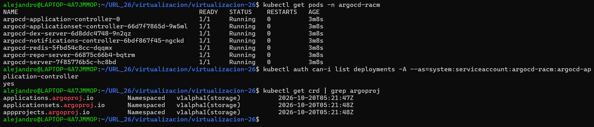

## 7. Exposure through Traefik

### 7.1 Ingress

```yaml
apiVersion: networking.k8s.io/v1
kind: Ingress
metadata:
  name: argocd-server
  namespace: argocd-racm
spec:
  ingressClassName: traefik
  rules:
    - host: argocd.racm.assessment6
      http:
        paths:
          - path: /
            pathType: Prefix
            backend:
              service:
                name: argocd-server
                port:
                  name: http
```

File: [argocd/ingress.yaml](./argocd/ingress.yaml)

```bash
kubectl apply --dry-run=server -f argocd/ingress.yaml
kubectl apply --server-side --force-conflicts -k argocd/
kubectl get ingress -n argocd-racm
curl -I -H "Host: argocd.racm.assessment6" http://192.168.49.200
```

Result before disabling TLS on the server: `HTTP/1.1 307 Temporary Redirect` to `https://argocd.racm.assessment6/`.

### 7.2 Disable TLS on `argocd-server`

Final kustomization:

```yaml
apiVersion: kustomize.config.k8s.io/v1beta1
kind: Kustomization
namespace: argocd-racm
resources:
  - 00-namespace.yaml
  - install.yaml
  - ingress.yaml
  - repository.yaml
patches:
  - target:
      kind: ClusterRoleBinding
    patch: |-
      - op: replace
        path: /subjects/0/namespace
        value: argocd-racm
  - target:
      kind: ConfigMap
      name: argocd-cmd-params-cm
    patch: |-
      apiVersion: v1
      kind: ConfigMap
      metadata:
        name: argocd-cmd-params-cm
      data:
        server.insecure: "true"
```

File: [argocd/kustomization.yaml](./argocd/kustomization.yaml)

```bash
kubectl apply --server-side --force-conflicts -k argocd/
kubectl rollout restart deployment argocd-server -n argocd-racm
kubectl rollout status deployment argocd-server -n argocd-racm
curl -I -H "Host: argocd.racm.assessment6" http://192.168.49.200
```

Result: `HTTP/1.1 200 OK`.

### 7.3 WSL (`/etc/hosts`)

```bash
grep -A1 network /etc/wsl.conf
sudo cp /etc/hosts /etc/hosts.bak
echo "192.168.49.200 argocd.racm.assessment6" | sudo tee -a /etc/hosts
getent hosts argocd.racm.assessment6
curl -I http://argocd.racm.assessment6
```

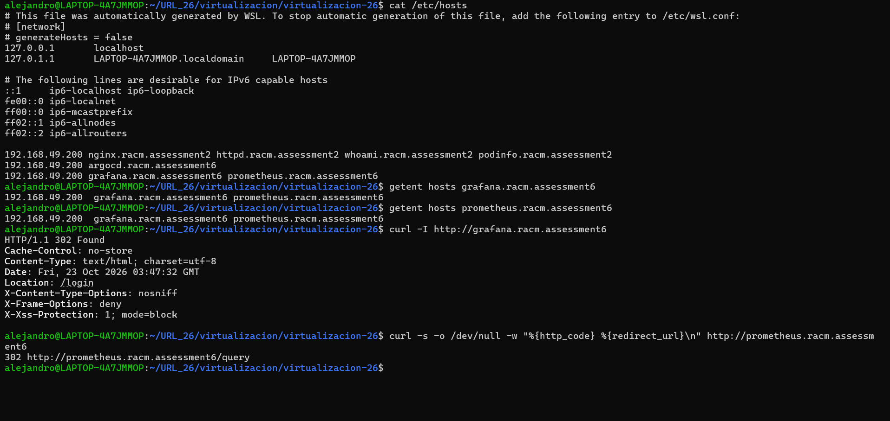

### 7.4 Windows (`C:\Windows\System32\drivers\etc\hosts`)

```powershell
Copy-Item C:\Windows\System32\drivers\etc\hosts C:\Windows\System32\drivers\etc\hosts.bak
notepad C:\Windows\System32\drivers\etc\hosts
ipconfig /flushdns
Resolve-DnsName argocd.racm.assessment6
curl.exe -I http://argocd.racm.assessment6
```

```
192.168.49.200 argocd.racm.assessment6
```

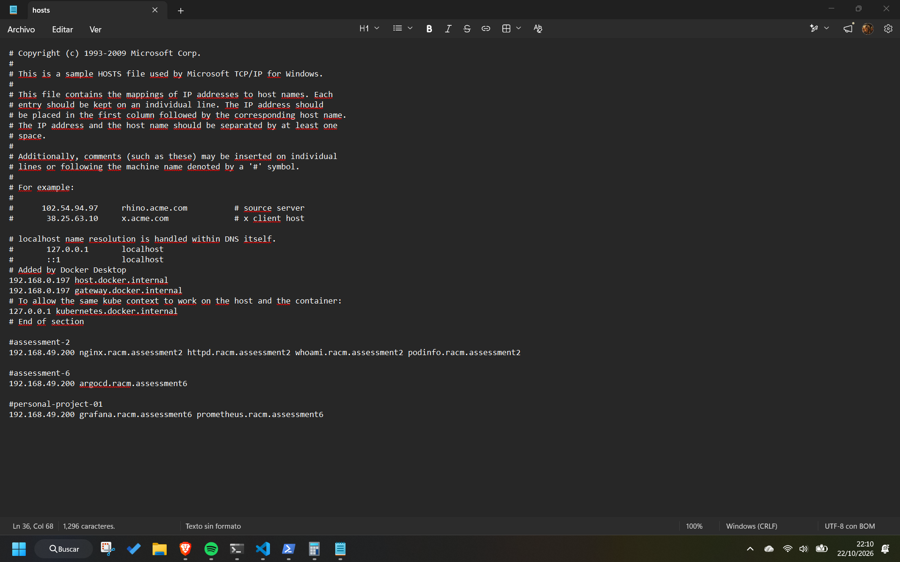

### 7.5 Browser Access

Initial `admin` password (not stored in this repository):

```bash
kubectl -n argocd-racm get secret argocd-initial-admin-secret -o jsonpath='{.data.password}' | base64 -d; echo
```

URL: `http://argocd.racm.assessment6/`

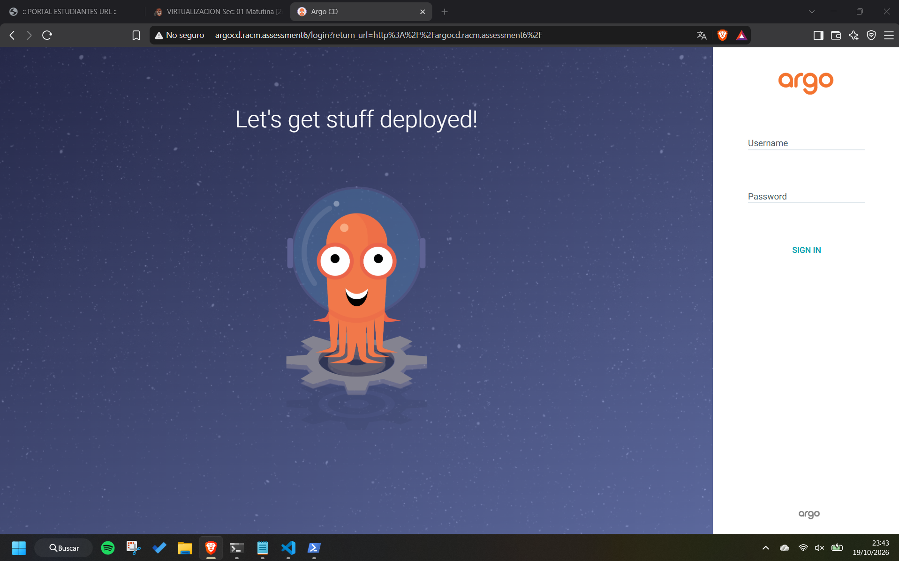

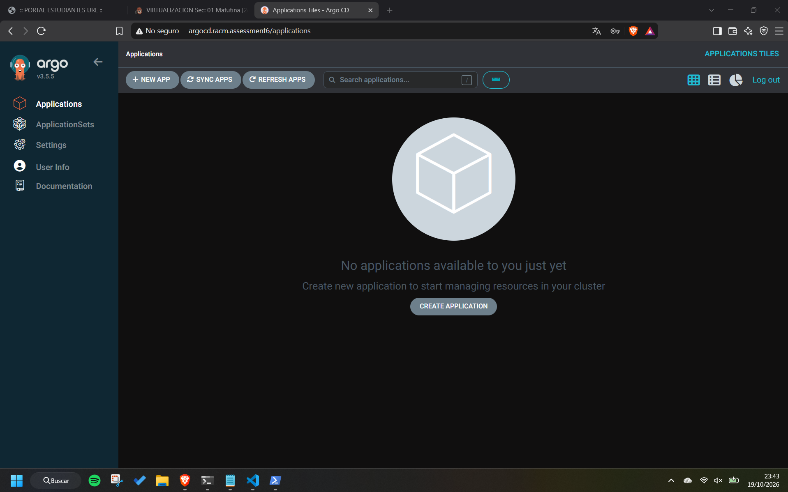

## 8. Repository Connection

```yaml
apiVersion: v1
kind: Secret
metadata:
  name: virtualizacion-26-repo
  namespace: argocd-racm
  labels:
    argocd.argoproj.io/secret-type: repository
stringData:
  type: git
  url: https://github.com/alejandrocald13/virtualizacion-26.git
```

File: [argocd/repository.yaml](./argocd/repository.yaml)

```bash
kubectl apply --dry-run=server -f argocd/repository.yaml
kubectl apply --server-side --force-conflicts -k argocd/
kubectl get secret -n argocd-racm -l argocd.argoproj.io/secret-type=repository
```

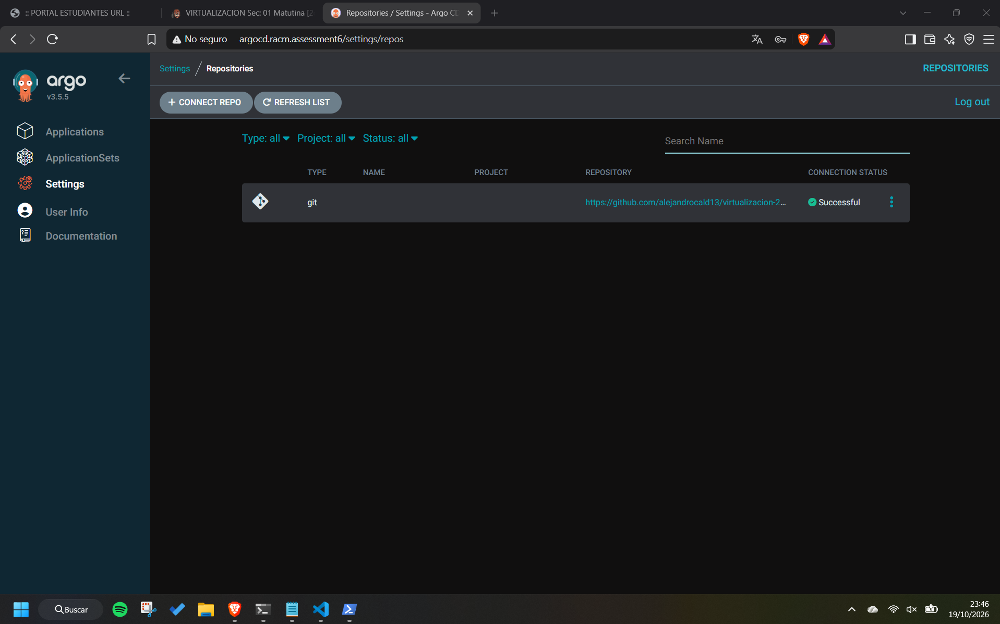

## 9. Applications

### 9.1 Clean the Namespace

The resources applied manually in `assessment-02` were removed so that Argo CD creates them from Git:

```bash
kubectl delete namespace parcial-racm
kubectl get ns parcial-racm
```

### 9.2 Application Manifests

```yaml
apiVersion: argoproj.io/v1alpha1
kind: Application
metadata:
  name: nginx
  namespace: argocd-racm
spec:
  project: default
  source:
    repoURL: https://github.com/alejandrocald13/virtualizacion-26.git
    targetRevision: assessment-06
    path: apps
    directory:
      include: nginx.yaml
  destination:
    server: https://kubernetes.default.svc
    namespace: parcial-racm
  syncPolicy:
    automated:
      prune: true
      selfHeal: true
    syncOptions:
      - CreateNamespace=true
```

The `httpd` Application is identical, with `name: httpd` and `include: httpd.yaml`.

- [argocd/applications/nginx.yaml](./argocd/applications/nginx.yaml)
- [argocd/applications/httpd.yaml](./argocd/applications/httpd.yaml)

| App | Image | Replicas (before) | Host |
|---|---|---|---|
| nginx | `nginx:1.27` | 3 | `nginx.racm.assessment2` |
| httpd | `httpd:2.4` | 3 | `httpd.racm.assessment2` |

### 9.3 Creation and Verification

```bash
kubectl apply -f argocd/applications/
kubectl get applications -n argocd-racm
kubectl get deploy,svc,ingress -n parcial-racm
kubectl get deploy nginx -n parcial-racm -o jsonpath='{.metadata.annotations.argocd\.argoproj\.io/tracking-id}'; echo
curl -s http://nginx.racm.assessment2 | head -n 4
curl -s http://httpd.racm.assessment2 | head -n 4
```

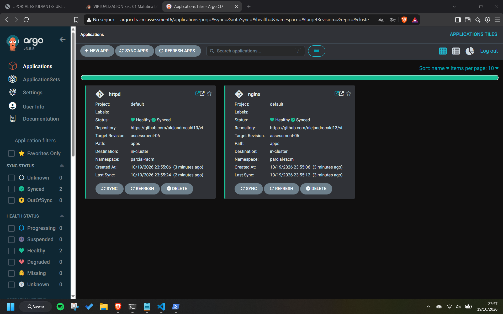

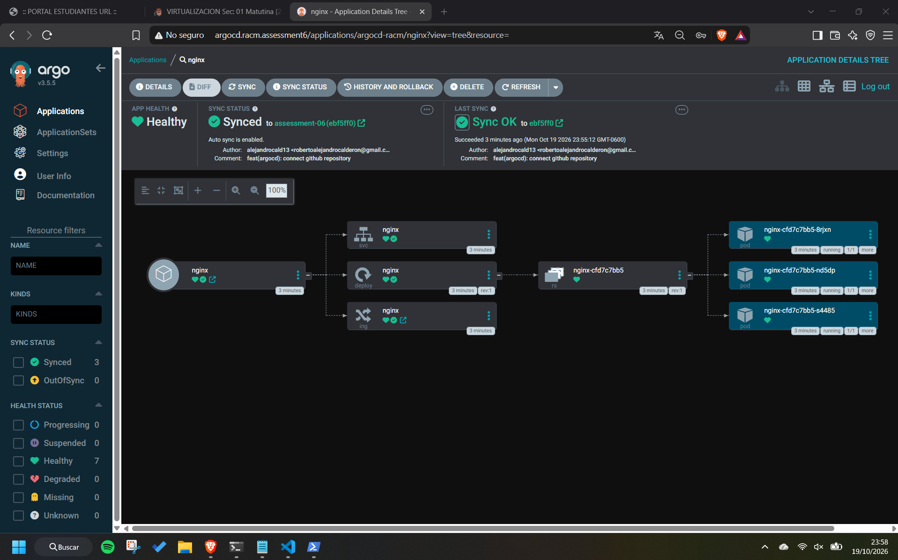

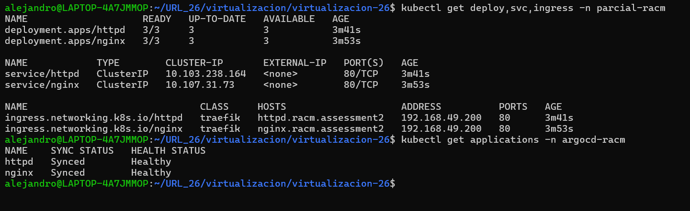

## 10. GitOps Change Synchronization

### 10.1 Change in Git

```diff
 spec:
-  replicas: 3
+  replicas: 5
```

File: [apps/nginx.yaml](./apps/nginx.yaml)

Commit `8b03e84` (`feat(apps): scale nginx to 5 replicas`), pushed to `origin/assessment-06`:

```bash
git push
```

### 10.2 Synchronization

```bash
kubectl get deploy nginx -n parcial-racm -w
kubectl get applications -n argocd-racm -o custom-columns=NAME:.metadata.name,SYNC:.status.sync.status,HEALTH:.status.health.status,REV:.status.sync.revision
git rev-parse HEAD
kubectl get deploy -n parcial-racm
```

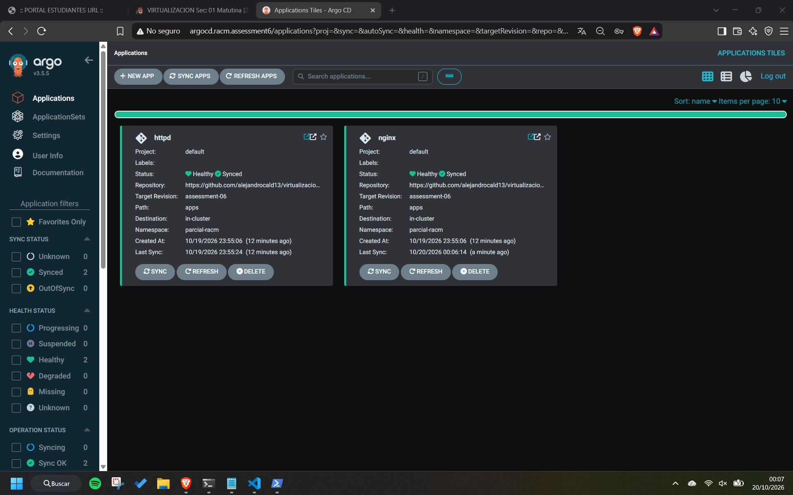

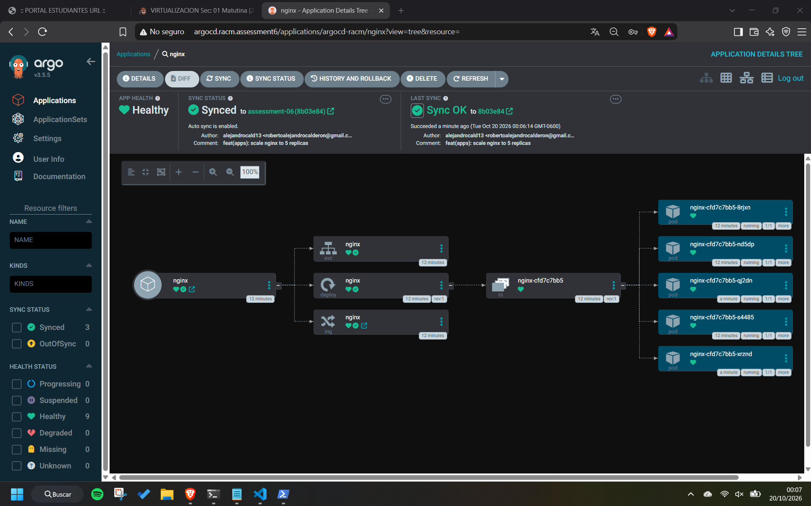

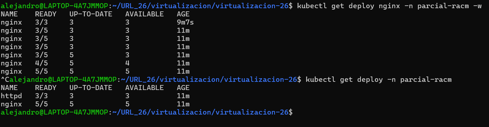

### 10.3 Self-Heal

```bash
kubectl get deploy nginx -n parcial-racm -w
kubectl scale deployment nginx -n parcial-racm --replicas=1
```

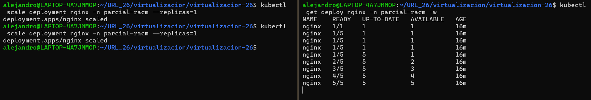

## 11. Repository

- **GitHub Repository:** *https://github.com/alejandrocald13/virtualizacion-26*
- **Branch:** `assessment-06`
