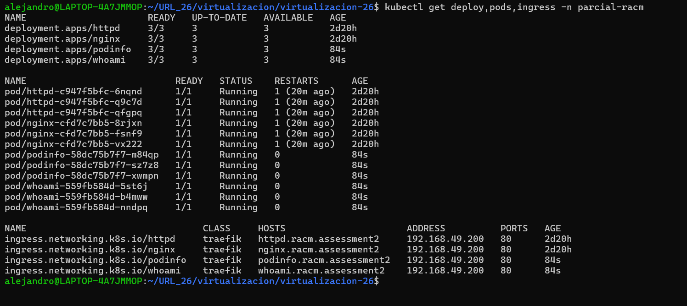
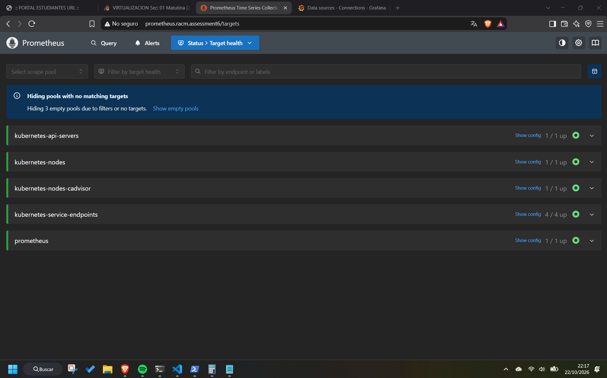
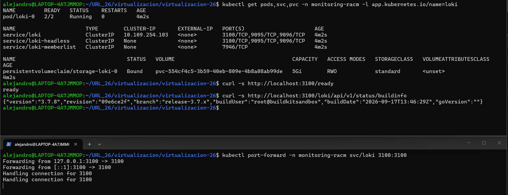
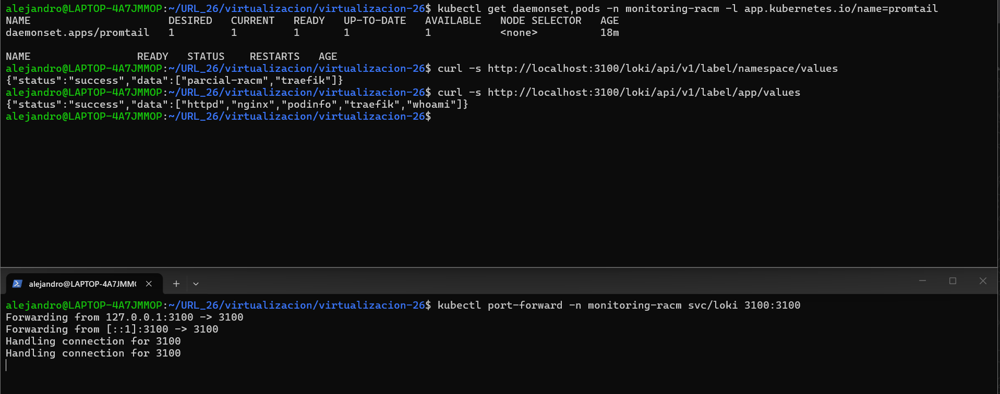
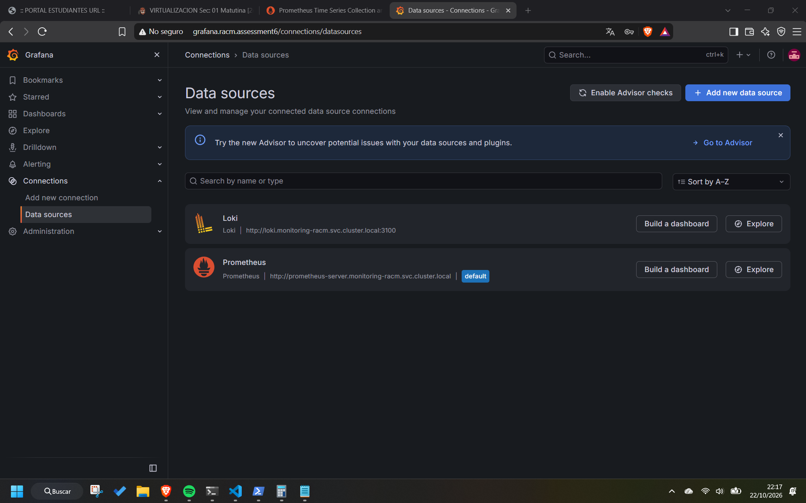
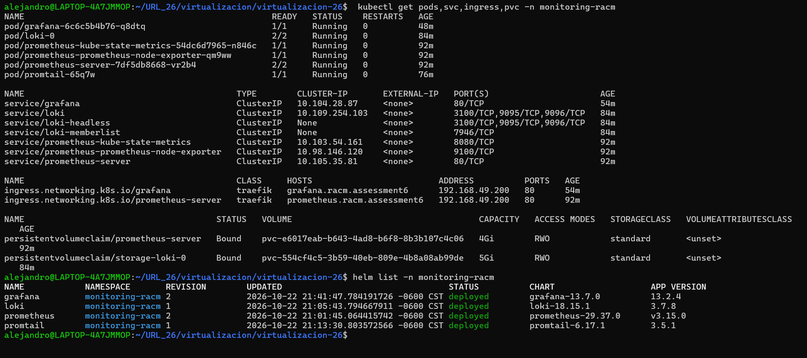
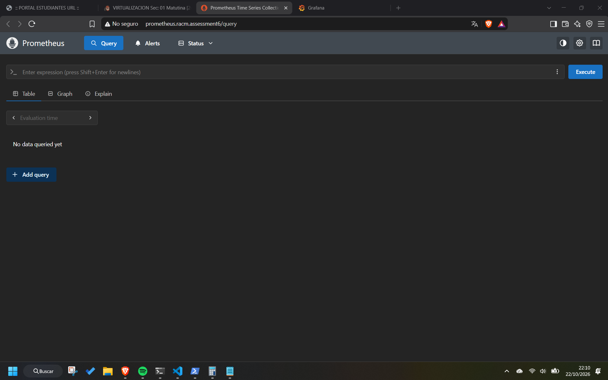
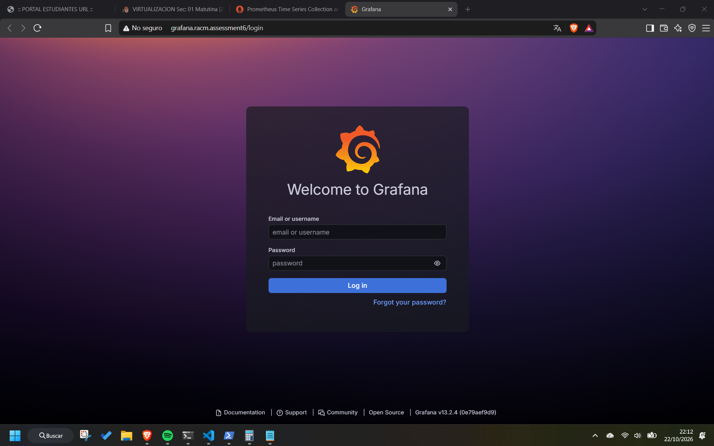
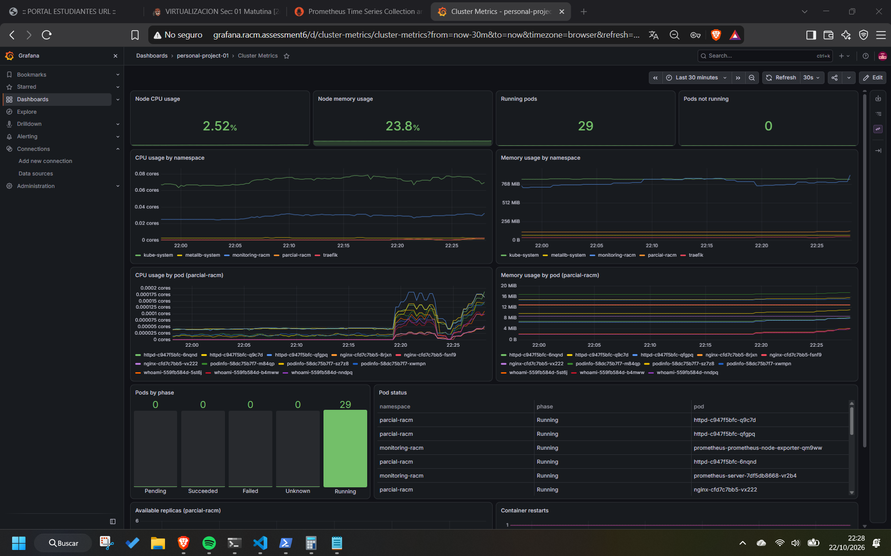
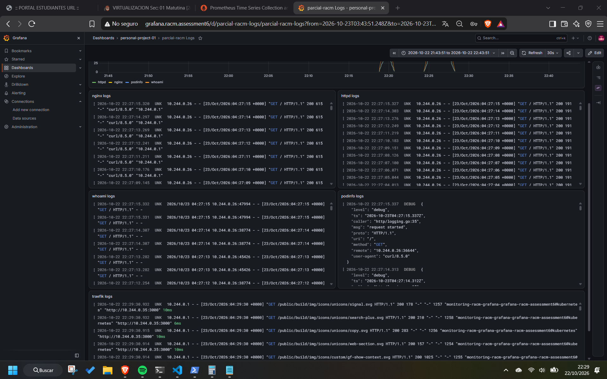

# Personal Project 01 — Monitoring and Centralized Logs on Minikube

## 1. Overview

This project installs a monitoring and log centralization stack inside the Minikube cluster from the previous assessments (MetalLB + Traefik). Prometheus collects cluster metrics, Promtail (DaemonSet) ships container logs to Loki, and Grafana reads both through data sources and dashboards provisioned as code. Grafana and Prometheus are exposed through Traefik using the MetalLB load balancer IP and local domain names.

- **Student:** Roberto Calderón
- **Monitoring namespace:** `monitoring-racm`
- **Applications namespace:** `parcial-racm` (nginx, httpd, whoami, podinfo)
- **Load balancer IP (Traefik):** `192.168.49.200`
- **Grafana domain:** `grafana.racm.assessment6`
- **Prometheus domain:** `prometheus.racm.assessment6`
- **Branch:** `personal-project-01`

## 2. Environment

| Component | Value |
|---|---|
| Host OS | Windows + WSL2 (Ubuntu 24.04, NAT networking) |
| Kubernetes | Minikube v1.39.0 (driver `docker`, runtime `containerd`, 3900 MB, 2 CPUs), server v1.37.0 |
| kubectl | v1.37.1 (built-in Kustomize v5.8.1) |
| Docker | Docker Engine 29.9.1 (native in WSL2) |
| Minikube node IP | `192.168.49.2` (Docker network `minikube`, `192.168.49.0/24`) |
| MetalLB | v0.16.1 (namespace `metallb-system`) |
| Traefik | v3.7.13 (namespace `traefik`) |
| Helm | v4.3.1 |
| Prometheus | chart `prometheus-community/prometheus` 29.37.0 (Prometheus v3.15.0, kube-state-metrics v2.20.0, node-exporter v1.12.1) |
| Loki | chart `grafana-community/loki` 18.15.1 (Loki 3.7.8, monolithic mode) |
| Promtail | chart `grafana/promtail` 6.17.1 (image `grafana/promtail:3.6.11`) |
| Grafana | chart `grafana-community/grafana` 13.7.0 (Grafana 13.2.4) |

> The Promtail chart is deprecated upstream (Promtail reached end of life). It is used because the assessment requires Promtail; the last chart version and the last published image were pinned.

## 3. Architecture

```
Windows browser: http://grafana.racm.assessment6 | http://prometheus.racm.assessment6
        |
        v
hosts file: 192.168.49.200
        |
        v
MetalLB (L2)  ->  Service traefik (LoadBalancer)                    [namespace traefik]
        |
        v
Traefik  ->  Ingress grafana            ->  Service grafana         [namespace monitoring-racm]
         ->  Ingress prometheus-server  ->  Service prometheus-server


Metrics (pull):
Prometheus  --scrapes-->  kube-apiserver, kubelet/cAdvisor, kube-state-metrics,
                          node-exporter, CoreDNS

Logs (push):
/var/log/pods (node)  ->  Promtail (DaemonSet)  ->  Loki (/loki/api/v1/push)
  namespaces: parcial-racm (nginx, httpd, whoami, podinfo) and traefik

Visualization:
Grafana  ->  data source Prometheus (uid prometheus)
         ->  data source Loki       (uid loki)
         ->  dashboards: Cluster Metrics, parcial-racm Logs
```

## 4. Repository Structure

```
.
├── README.md
├── metallb/
│   ├── metallb-native.yaml
│   ├── ipaddresspool.yaml
│   └── l2advertisement.yaml
├── traefik/
│   ├── 00-namespace.yaml
│   ├── 01-rbac.yaml
│   ├── 02-ingressclass.yaml
│   ├── 03-deployment.yaml
│   └── 04-service.yaml
├── apps/
│   ├── 00-namespace.yaml
│   ├── nginx.yaml
│   ├── httpd.yaml
│   ├── whoami.yaml
│   └── podinfo.yaml
├── monitoring/
│   ├── 00-namespace.yaml
│   ├── prometheus/
│   │   └── values.yaml
│   ├── loki/
│   │   └── values.yaml
│   ├── promtail/
│   │   └── values.yaml
│   └── grafana/
│       ├── values.yaml
│       └── dashboards/
│           ├── kustomization.yaml
│           ├── cluster-metrics.json
│           └── parcial-racm-logs.json
└── docs/
```

## 5. Prerequisites

### 5.1 Start the Cluster

```bash
sudo systemctl start docker
minikube start
kubectl get pods -A
kubectl get node minikube --show-labels | grep exclude-from-external
kubectl label node minikube node.kubernetes.io/exclude-from-external-load-balancers-
kubectl get svc -n traefik
curl -i http://192.168.49.200
```

### 5.2 Network Access from Windows

> These steps are only required by this specific environment (Windows + WSL2 with native Docker Engine), where the Minikube Docker network lives inside WSL and Windows cannot reach it by default. They are lost after every WSL or Docker restart, and the WSL IP changes after every WSL restart.

WSL:

```bash
ip -br link | grep br-
ip -4 addr show eth0 | grep inet
sudo iptables -I DOCKER-USER -i eth0 -o br-a6ebb5719eea -j ACCEPT
sudo iptables -L DOCKER-USER -v -n --line-numbers
```

Windows (PowerShell as administrator), using the current WSL IP:

```powershell
route delete 192.168.49.0
route add 192.168.49.0 mask 255.255.255.0 <WSL_IP>
Test-NetConnection 192.168.49.200 -Port 80
```

### 5.3 Infrastructure and Applications from assessment-02

```bash
git checkout assessment-02 -- metallb traefik apps
```

### 5.4 Remove Argo CD from assessment-06

The Argo CD Applications have no resources finalizer, so deleting them keeps the workloads running:

```bash
kubectl get applications -n argocd-racm -o custom-columns=NAME:.metadata.name,FINALIZERS:.metadata.finalizers
kubectl delete applications --all -n argocd-racm
kubectl get deploy -n parcial-racm
kubectl delete namespace argocd-racm
kubectl delete crd,clusterrole,clusterrolebinding -l app.kubernetes.io/part-of=argocd
kubectl get crd | grep argoproj
```

### 5.5 Request Logging in the Applications

`apps/whoami.yaml`:

```yaml
          image: traefik/whoami:v1.12.0
          args:
            - --verbose
```

`apps/podinfo.yaml`:

```yaml
          image: stefanprodan/podinfo:6.15.0
          env:
            - name: PODINFO_LEVEL
              value: debug
```

```bash
kubectl apply --dry-run=server -f apps/
kubectl apply -f apps/
kubectl get deploy,pods,ingress -n parcial-racm
```

Files: [apps/whoami.yaml](./apps/whoami.yaml), [apps/podinfo.yaml](./apps/podinfo.yaml)



### 5.6 Traefik Access Logs

`traefik/03-deployment.yaml` (container args):

```yaml
            - --log.level=INFO
            - --accesslog=true
```

```bash
kubectl apply -f traefik/03-deployment.yaml
kubectl rollout status deployment traefik -n traefik
curl -s -o /dev/null http://nginx.racm.assessment2
kubectl logs -n traefik deploy/traefik --tail=3
```

File: [traefik/03-deployment.yaml](./traefik/03-deployment.yaml)

### 5.7 Helm

```bash
cd /tmp
curl -fLO https://get.helm.sh/helm-v4.3.1-linux-amd64.tar.gz
curl -fL https://get.helm.sh/helm-v4.3.1-linux-amd64.tar.gz.sha256sum | sha256sum -c -
tar -xzf helm-v4.3.1-linux-amd64.tar.gz
sudo install -m 0755 linux-amd64/helm /usr/local/bin/helm
rm -rf linux-amd64 helm-v4.3.1-linux-amd64.tar.gz
cd -
helm version
```

```bash
helm repo add prometheus-community https://prometheus-community.github.io/helm-charts
helm repo add grafana https://grafana.github.io/helm-charts
helm repo add grafana-community https://grafana-community.github.io/helm-charts
helm repo update
```

### 5.8 Monitoring Namespace

```yaml
apiVersion: v1
kind: Namespace
metadata:
  name: monitoring-racm
```

```bash
kubectl apply -f monitoring/00-namespace.yaml
```

File: [monitoring/00-namespace.yaml](./monitoring/00-namespace.yaml)

## 6. Prometheus

### 6.1 Values

```yaml
server:
  retention: "3d"
  persistentVolume:
    enabled: true
    size: 4Gi
  resources:
    requests:
      cpu: 100m
      memory: 256Mi
    limits:
      memory: 1Gi
  ingress:
    enabled: true
    ingressClassName: traefik
    hosts:
      - prometheus.racm.assessment6
    path: /
    pathType: Prefix

scrapeConfigs:
  prometheus-pushgateway:
    enabled: false
  kubernetes-services:
    enabled: false
  kubernetes-pods:
    pre_relabel_configs: |
      - source_labels:
          - __meta_kubernetes_namespace
        regex: metallb-system
        action: drop

alertmanager:
  enabled: false
prometheus-pushgateway:
  enabled: false

kube-state-metrics:
  enabled: true
prometheus-node-exporter:
  enabled: true
```

File: [monitoring/prometheus/values.yaml](./monitoring/prometheus/values.yaml)

MetalLB pods are dropped from the `kubernetes-pods` job because they expose their metrics over authenticated HTTPS (port `metricshttps`, 9120) and would show as `DOWN`.

### 6.2 Installation

```bash
helm template prometheus prometheus-community/prometheus --version 29.37.0 -n monitoring-racm -f monitoring/prometheus/values.yaml | grep '^kind:' | sort | uniq -c
helm upgrade --install prometheus prometheus-community/prometheus --version 29.37.0 -n monitoring-racm -f monitoring/prometheus/values.yaml
kubectl rollout status deployment prometheus-server -n monitoring-racm --timeout=300s
kubectl get pods,svc,pvc,ingress -n monitoring-racm
```

### 6.3 Verification

```bash
curl -s -H "Host: prometheus.racm.assessment6" http://192.168.49.200/-/ready
curl -s -H "Host: prometheus.racm.assessment6" http://192.168.49.200/api/v1/targets | python3 -c 'import json,sys; [print(t["health"], t["labels"].get("job"), t["scrapeUrl"]) for t in json.load(sys.stdin)["data"]["activeTargets"]]'
```

Active jobs: `prometheus`, `kubernetes-api-servers`, `kubernetes-nodes`, `kubernetes-nodes-cadvisor`, `kubernetes-service-endpoints` (CoreDNS, kube-state-metrics, node-exporter).



## 7. Loki

### 7.1 Values

```yaml
deploymentMode: Monolithic

loki:
  auth_enabled: false
  commonConfig:
    replication_factor: 1
  storage:
    type: filesystem
  schemaConfig:
    configs:
      - from: "2024-04-01"
        store: tsdb
        object_store: filesystem
        schema: v13
        index:
          prefix: loki_index_
          period: 24h
  limits_config:
    retention_period: 72h
  compactor:
    retention_enabled: true
    delete_request_store: filesystem

singleBinary:
  replicas: 1
  persistence:
    enabled: true
    size: 5Gi
  resources:
    requests:
      cpu: 100m
      memory: 256Mi
    limits:
      memory: 1Gi

gateway:
  enabled: false
chunksCache:
  enabled: false
resultsCache:
  enabled: false
lokiCanary:
  enabled: false
test:
  enabled: false
minio:
  enabled: false

backend:
  replicas: 0
read:
  replicas: 0
write:
  replicas: 0
```

File: [monitoring/loki/values.yaml](./monitoring/loki/values.yaml)

### 7.2 Installation

```bash
helm template loki grafana-community/loki --version 18.15.1 -n monitoring-racm -f monitoring/loki/values.yaml | grep '^kind:' | sort | uniq -c
helm upgrade --install loki grafana-community/loki --version 18.15.1 -n monitoring-racm -f monitoring/loki/values.yaml
kubectl rollout status statefulset loki -n monitoring-racm --timeout=300s
kubectl get pods,svc,pvc -n monitoring-racm -l app.kubernetes.io/name=loki
```

### 7.3 Verification

```bash
kubectl port-forward -n monitoring-racm svc/loki 3100:3100
curl -s http://localhost:3100/ready
curl -s http://localhost:3100/loki/api/v1/status/buildinfo
```



## 8. Promtail

### 8.1 Values

```yaml
image:
  tag: 3.6.11

config:
  clients:
    - url: http://loki.monitoring-racm.svc.cluster.local:3100/loki/api/v1/push
  snippets:
    extraRelabelConfigs:
      - source_labels:
          - namespace
        regex: parcial-racm|traefik
        action: keep

resources:
  requests:
    cpu: 50m
    memory: 64Mi
  limits:
    memory: 256Mi
```

File: [monitoring/promtail/values.yaml](./monitoring/promtail/values.yaml)

Log collection:

- Promtail runs as a DaemonSet and reads the container logs of each node from `/var/log/pods` (`hostPath`), parsed with the `cri` pipeline stage (containerd format).
- Pods are discovered with `kubernetes_sd_configs` (role `pod`), and each stream gets the labels `namespace`, `pod`, `container`, `app`, `node_name` and `job`.
- The `keep` rule only ships the logs of the namespaces `parcial-racm` (nginx, httpd, whoami, podinfo) and `traefik`.

### 8.2 Installation

```bash
helm upgrade --install promtail grafana/promtail --version 6.17.1 -n monitoring-racm -f monitoring/promtail/values.yaml
kubectl rollout status daemonset promtail -n monitoring-racm --timeout=180s
kubectl get daemonset,pods -n monitoring-racm -l app.kubernetes.io/name=promtail
kubectl logs -n monitoring-racm daemonset/promtail --tail=20
```

### 8.3 Verification

```bash
kubectl port-forward -n monitoring-racm daemonset/promtail 3101:3101
curl -s http://localhost:3101/ready
curl -s http://localhost:3101/targets | grep -o 'parcial-racm/[a-z]*' | sort | uniq -c
curl -s http://localhost:3100/loki/api/v1/label/namespace/values
curl -s http://localhost:3100/loki/api/v1/label/app/values
```



## 9. Grafana

### 9.1 Values (data sources and dashboards as code)

```yaml
adminUser: admin

testFramework:
  enabled: false

ingress:
  enabled: true
  ingressClassName: traefik
  hosts:
    - grafana.racm.assessment6
  path: /
  pathType: Prefix

grafana.ini:
  server:
    root_url: http://grafana.racm.assessment6

resources:
  requests:
    cpu: 100m
    memory: 128Mi
  limits:
    memory: 512Mi

datasources:
  datasources.yaml:
    apiVersion: 1
    datasources:
      - name: Prometheus
        type: prometheus
        uid: prometheus
        access: proxy
        url: http://prometheus-server.monitoring-racm.svc.cluster.local
        isDefault: true
        editable: false
      - name: Loki
        type: loki
        uid: loki
        access: proxy
        url: http://loki.monitoring-racm.svc.cluster.local:3100
        editable: false

dashboardProviders:
  dashboardproviders.yaml:
    apiVersion: 1
    providers:
      - name: racm
        orgId: 1
        folder: personal-project-01
        type: file
        disableDeletion: true
        editable: false
        options:
          path: /var/lib/grafana/dashboards/racm

dashboardsConfigMaps:
  racm: grafana-dashboards
```

File: [monitoring/grafana/values.yaml](./monitoring/grafana/values.yaml)

- `datasources` is rendered by the chart into `/etc/grafana/provisioning/datasources/datasources.yaml`.
- `dashboardProviders` is rendered into `/etc/grafana/provisioning/dashboards/dashboardproviders.yaml`.
- `dashboardsConfigMaps` mounts the ConfigMap `grafana-dashboards` into `/var/lib/grafana/dashboards/racm`.
- The admin password is generated by the chart and stored in the Secret `grafana`; it is not stored in this repository.

### 9.2 Dashboards ConfigMap

```yaml
apiVersion: kustomize.config.k8s.io/v1beta1
kind: Kustomization
namespace: monitoring-racm
generatorOptions:
  disableNameSuffixHash: true
configMapGenerator:
  - name: grafana-dashboards
    files:
      - cluster-metrics.json
      - parcial-racm-logs.json
```

Files:

- [monitoring/grafana/dashboards/kustomization.yaml](./monitoring/grafana/dashboards/kustomization.yaml)
- [monitoring/grafana/dashboards/cluster-metrics.json](./monitoring/grafana/dashboards/cluster-metrics.json)
- [monitoring/grafana/dashboards/parcial-racm-logs.json](./monitoring/grafana/dashboards/parcial-racm-logs.json)

### 9.3 Installation

```bash
python3 -m json.tool monitoring/grafana/dashboards/cluster-metrics.json > /dev/null && echo OK
python3 -m json.tool monitoring/grafana/dashboards/parcial-racm-logs.json > /dev/null && echo OK
kubectl apply -k monitoring/grafana/dashboards/
helm upgrade --install grafana grafana-community/grafana --version 13.7.0 -n monitoring-racm -f monitoring/grafana/values.yaml
kubectl rollout status deployment grafana -n monitoring-racm --timeout=300s
```

Admin password (not stored in this repository):

```bash
kubectl -n monitoring-racm get secret grafana -o jsonpath='{.data.admin-password}' | base64 -d; echo
```

### 9.4 Verification

```bash
GRAFANA_PASSWORD=$(kubectl -n monitoring-racm get secret grafana -o jsonpath='{.data.admin-password}' | base64 -d)
curl -s -u admin:$GRAFANA_PASSWORD -H "Host: grafana.racm.assessment6" http://192.168.49.200/api/datasources | python3 -m json.tool | grep -E '"(name|uid|url|readOnly)"'
curl -s -u admin:$GRAFANA_PASSWORD -H "Host: grafana.racm.assessment6" http://192.168.49.200/api/datasources/uid/prometheus/health
curl -s -u admin:$GRAFANA_PASSWORD -H "Host: grafana.racm.assessment6" http://192.168.49.200/api/datasources/uid/loki/health
curl -s -u admin:$GRAFANA_PASSWORD -H "Host: grafana.racm.assessment6" "http://192.168.49.200/api/search?query=" | python3 -m json.tool | grep -E '"(uid|title|folderTitle)"'
kubectl get pods,svc,ingress,pvc -n monitoring-racm
helm list -n monitoring-racm
```





## 10. Exposure through Traefik and DNS

### 10.1 Ingress

Both Ingress resources are created by the Helm charts from the values above (`ingressClassName: traefik`):

| Ingress | Host | Service |
|---|---|---|
| `prometheus-server` | `prometheus.racm.assessment6` | `prometheus-server:80` |
| `grafana` | `grafana.racm.assessment6` | `grafana:80` |

```bash
kubectl get ingress -n monitoring-racm
curl -s -o /dev/null -w "%{http_code} %{redirect_url}\n" -H "Host: prometheus.racm.assessment6" http://192.168.49.200/
curl -I -H "Host: grafana.racm.assessment6" http://192.168.49.200/
```

### 10.2 WSL (`/etc/hosts`)

```bash
grep -A1 network /etc/wsl.conf
sudo cp /etc/hosts /etc/hosts.bak
echo "192.168.49.200 grafana.racm.assessment6 prometheus.racm.assessment6" | sudo tee -a /etc/hosts
getent hosts grafana.racm.assessment6
getent hosts prometheus.racm.assessment6
curl -I http://grafana.racm.assessment6
curl -s -o /dev/null -w "%{http_code} %{redirect_url}\n" http://prometheus.racm.assessment6
```


### 10.3 Windows (`C:\Windows\System32\drivers\etc\hosts`)

```powershell
Copy-Item C:\Windows\System32\drivers\etc\hosts C:\Windows\System32\drivers\etc\hosts.bak
notepad C:\Windows\System32\drivers\etc\hosts
ipconfig /flushdns
Resolve-DnsName grafana.racm.assessment6
curl.exe -I http://grafana.racm.assessment6
```

```
192.168.49.200 grafana.racm.assessment6 prometheus.racm.assessment6
```


### 10.4 Browser Access

- Prometheus: `http://prometheus.racm.assessment6/`
- Grafana: `http://grafana.racm.assessment6/` (user `admin`)





## 11. Dashboards

### 11.1 Traffic Generation

```bash
for i in $(seq 1 60); do
  for app in nginx httpd whoami podinfo; do
    curl -s -o /dev/null http://$app.racm.assessment2/
  done
  sleep 1
done
```

### 11.2 Cluster Metrics (`cluster-metrics.json`)

| Panel | Query (PromQL) |
|---|---|
| Node CPU usage | `100 * sum(rate(node_cpu_seconds_total{mode!="idle"}[5m])) / count(node_cpu_seconds_total{mode="idle"})` |
| Node memory usage | `100 * (1 - node_memory_MemAvailable_bytes / node_memory_MemTotal_bytes)` |
| Running pods | `sum(kube_pod_status_phase{phase="Running"})` |
| Pods not running | `sum(kube_pod_status_phase{phase=~"Pending\|Failed\|Unknown"})` |
| CPU usage by namespace | `sum by (namespace) (rate(container_cpu_usage_seconds_total{container!="", image!=""}[5m]))` |
| Memory usage by namespace | `sum by (namespace) (container_memory_working_set_bytes{container!="", image!=""})` |
| CPU usage by pod (parcial-racm) | `sum by (pod) (rate(container_cpu_usage_seconds_total{namespace="parcial-racm", container!="", image!=""}[5m]))` |
| Memory usage by pod (parcial-racm) | `sum by (pod) (container_memory_working_set_bytes{namespace="parcial-racm", container!="", image!=""})` |
| Pods by phase | `sum by (phase) (kube_pod_status_phase)` |
| Pod status | `max by (namespace, pod, phase) (kube_pod_status_phase{namespace=~"parcial-racm\|monitoring-racm\|traefik"} == 1)` |
| Available replicas (parcial-racm) | `kube_deployment_status_replicas_available{namespace="parcial-racm"}` |
| Container restarts | `sum by (namespace, pod) (kube_pod_container_status_restarts_total{namespace=~"parcial-racm\|monitoring-racm\|traefik"})` |



### 11.3 Application Logs (`parcial-racm-logs.json`)

| Panel | Query (LogQL) |
|---|---|
| Log lines per app (parcial-racm) | `sum by (app) (count_over_time({namespace="parcial-racm"}[1m]))` |
| nginx logs | `{namespace="parcial-racm", app="nginx"}` |
| httpd logs | `{namespace="parcial-racm", app="httpd"}` |
| whoami logs | `{namespace="parcial-racm", app="whoami"}` |
| podinfo logs | `{namespace="parcial-racm", app="podinfo"}` |
| traefik logs | `{namespace="traefik"}` |



## 12. Repository

- **GitHub Repository:** *https://github.com/alejandrocald13/virtualizacion-26*
- **Branch:** `personal-project-01`
